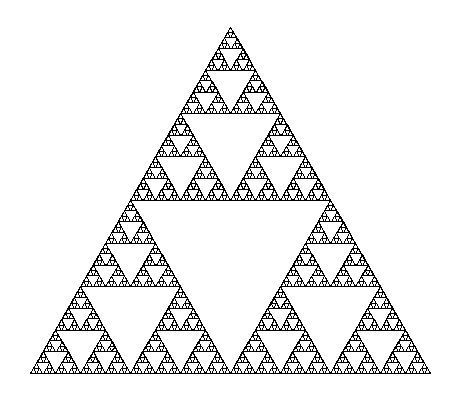
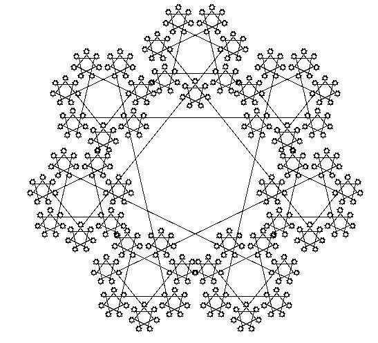

# how_i_learned_python

These are some old python scripts I wrote to teach myself python.

These scripts use a recursive function.
Recursive functions are functions that call themselves until a certain limit is reached.

## Images

### Koch Curve

### Sierpinski Triangle

### Recursive Stars

