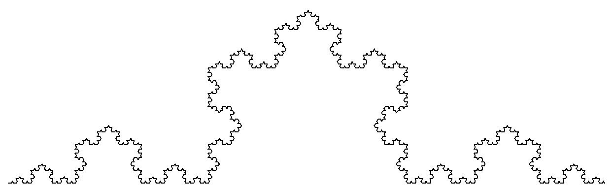
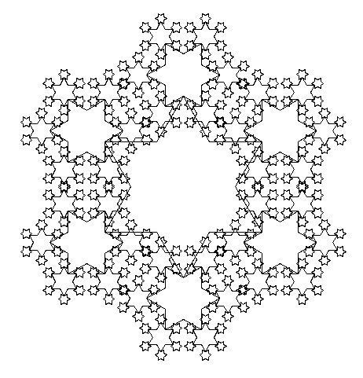
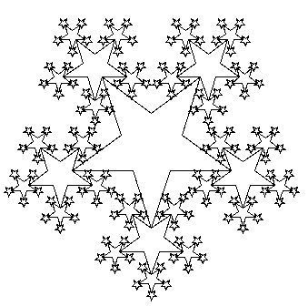
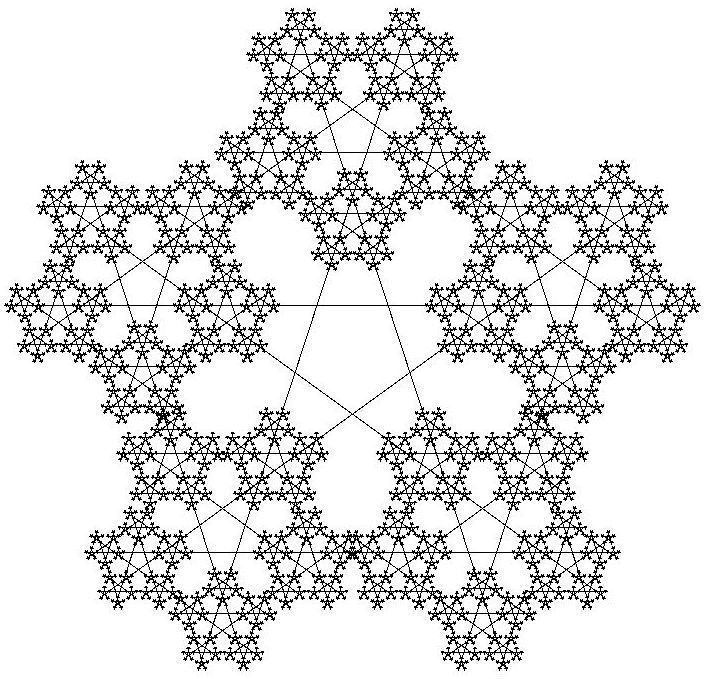

# how_i_learned_python

These are some old python scripts I wrote to teach myself python.

These scripts use a recursive function.
Recursive functions are functions that call themselves until a certain limit is reached.

## Images

### Koch Curve

[koch_01.py](koch_01.py)

### Sierpinski Triangle

[sierpinski_triangle_01.py](sierpinski_triangle_01.py)

### Recursive Stars
I cant recall now but I thought I had one that could only do even numbers, one that did odd, then I wrote one that did both.

[recursive_odd_n_point_star.py](recursive_odd_n_point_star.py)

[recursive_odd_n_point_star.py](recursive_odd_n_point_star.py)

